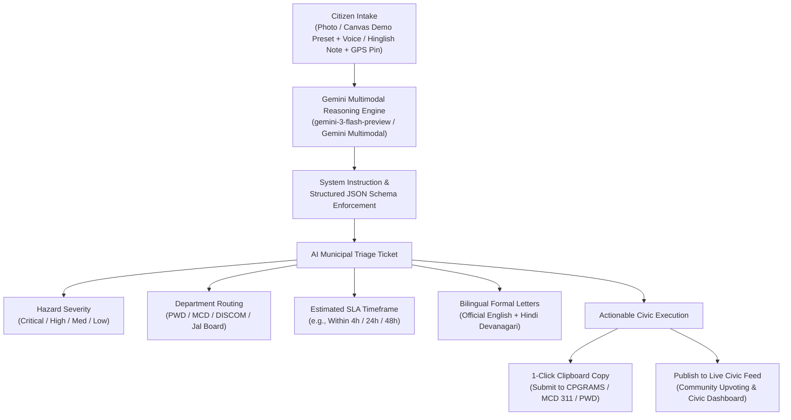

# 🏛️ CivicPulse AI — Local Civic & Municipal Issue Reporter

> **Built with Google Antigravity & Google Gemini API for the PROMPT WARS Hackathon**  
> *Transforming messy citizen complaints into structured municipal triage tickets and official bilingual grievance letters.*

[](https://ai.google.dev/)
[](https://antigravity.google/)
[](https://ai.google.dev/)
[](LICENSE)

---

## 📌 Executive Summary

Every day, millions of citizens encounter severe municipal hazards—crater-like potholes, overflowing garbage dumps, dangling live electrical wires, broken water mains, and non-functional streetlights. While citizens actively capture and post about these hazards on social media, **most civic complaints never lead to timely administrative action**.

**CivicPulse AI** bridges this gap using **Google Gemini** multimodal intelligence and prompt engineering. Citizens provide visual evidence (photo/preset), an informal description in **English, Hindi, or Hinglish** (via text or voice), and a GPS pin. In seconds, CivicPulse AI produces:

1. **A Structured Municipal Triage Ticket** with objective hazard classification, public safety assessment, and SLA timeframes.
2. **Intelligent Department Routing** to specific bodies (e.g., PWD, MCD/NDMC, DISCOMs, Jal Board).
3. **Formal Bilingual Municipal Grievance Letters** (in both official English and formal Hindi Devanagari script) formatted with administrative etiquette, ready for 1-click submission to portals like CPGRAMS, MCD 311, or PWD grievance cells.
4. **A Live Community Civic Feed & Triage Dashboard** with upvoting and severity filters for collective neighborhood advocacy.

---

## 🚨 Problem Statement

In Indian urban centers and towns, civic grievance redressal faces systemic friction points:

* **Unstructured & Informal Reporting**: Citizens describe urgent problems informally in mixed colloquial languages (*e.g., "Main road ke beech mein bahut bada gadda hai, raat ko bikes slip ho rahi hain"*). Municipal portals require rigid forms, technical descriptions, and administrative phrasing.
* **Lack of Hazard Triage & Prioritization**: A dangling live 440V wire near a school is often queued behind routine maintenance requests because traditional municipal complaint systems lack automated visual hazard assessment.
* **Misrouted Grievances**: Citizens rarely know whether a given pothole falls under the Public Works Department (PWD), Municipal Corporation (MCD/NDMC), National Highways Authority (NHAI), or Delhi Development Authority (DDA). Misrouted complaints bounce between departments for weeks.
* **Language & Literacy Barriers**: Official government portals frequently require formal written representations. Many citizens struggle to draft structured official complaints in administrative English or formal Hindi.
* **Community Blind Spots**: Duplicate complaints clog municipal servers while severe local hazards remain invisible to fellow residents without a centralized community feed.

---

## 💡 Solution: How CivicPulse AI Solves This

CivicPulse AI acts as an **intelligent civic copilot and automated municipal triage officer**:



---

## ✨ Key Features

### 1. 📷 Multimodal Visual Evidence Processing
* Accepts photo uploads directly from smartphones, tablets, or desktops (PNG, JPG, WEBP).
* Includes **3 built-in procedural HTML5 Canvas demo presets** (Deep Pothole, Overflowing Garbage Bin, Exposed Live Electrical Cable) enabling instant testing without requiring external images or network dependencies.

### 2. 🎙️ Multilingual Citizen Intake (English, Hindi, Hinglish) & Voice Input
* Supports natural conversational descriptions in pure English, pure Hindi, or colloquial **Hinglish** (code-mixed language common across India).
* Integrated with the **Web Speech API** (`SpeechRecognition` in `en-IN` / Hindi) for hands-free voice dictation, featuring automatic microphone visual indicators and graceful browser fallbacks.

### 3. 📍 One-Tap GPS Geolocation Pinning
* Uses the browser's **HTML5 Geolocation API** to pin exact latitude and longitude coordinates.
* Formats location data with neighborhood context (e.g., *Connaught Place, New Delhi*) to feed precise location tags into the municipal complaint.

### 4. 🧠 Deterministic Gemini Structured JSON Output (`responseSchema`)
* Harnesses Gemini's schema constraint capability (`responseMimeType: "application/json"` with strict `responseSchema`).
* Extracts 8 structured municipal data fields deterministically:
  * **Authoritative Issue Title** (max 12 words)
  * **Categorization** (`Roads & Potholes`, `Sanitation & Waste`, `Water & Drainage`, `Streetlights & Electrical`, `Public Safety`)
  * **Severity Classification** (`Critical`, `High`, `Medium`, `Low`)
  * **Hazard & Public Safety Reasoning** (1-2 sentence risk evaluation)
  * **Designated Municipal Department** (e.g., PWD, MCD, DISCOM, Delhi Jal Board)
  * **Service Level Agreement (SLA)** (e.g., *Within 4 Hours (Emergency)*, *Within 48 Hours*)
  * **Formal Municipal Grievance in English** (complete with *To*, *Subject*, *Body*, and *Sign-off*)
  * **Formal Municipal Grievance in Hindi** (natural administrative Devanagari translation)

### 5. 🇮🇳 Bilingual Municipal Grievance Generator
* Instant dual-language toggle between **English** and **हिन्दी (Hindi)**.
* Generates professionally phrased, legally sound, and respectful administrative grievance letters ready to paste into official portals or send via email.
* One-click **Copy to Clipboard** button with instant toast feedback.

### 6. 📊 Live Civic Feed & Community Triage Dashboard
* Real-time **Civic Feed** displaying community issues with severity badges and status indicators (*Open* vs. *Resolved*).
* **Live KPI Strip**: Total Reports, Critical Hazards (immediate dispatch), and Resolved issues.
* **Interactive Community Upvoting**: Citizens can upvote urgent issues to elevate public visibility and pressure authorities for prompt resolution.
* **Instant Filtering**: Filter by severity (*Critical*, *High*, *Medium*, *Low*) or civic category.
* **Modal Grievance Viewer**: Inspect full bilingual letters and details of any community post directly from the feed.

### 7. 🛡️ Resilient Architecture & Graceful Fallback
* **Exponential Backoff**: Implements `fetchWithBackoff` with retry mechanics for handling rate limits (`HTTP 429` / `500`).
* **Intelligent Offline Heuristic Engine**: If no network or API key is supplied, a built-in semantic heuristic classifier generates realistic municipal triage tickets, ensuring uninterrupted evaluation and demonstration.

---

## 🛠️ Tech Stack & Architecture

| Layer | Technologies Used | Description |
| :--- | :--- | :--- |
| **Artificial Intelligence** | **Google Gemini API** (`gemini-3-flash-preview` / Gemini Multimodal) | Multimodal visual inspection, multilingual semantic comprehension, safety risk assessment, and formal bilingual complaint drafting. |
| **Agentic Tooling** | **Google Antigravity** | Agentic workflow automation, rapid prototyping, and prompt refinement. |
| **Frontend Framework** | **HTML5 + Modern Vanilla JavaScript (ES6+)** | Zero-build, single-file architecture for instant portability and frictionless evaluation. |
| **Styling & Design System** | **Tailwind CSS (CDN) + Inter Font** | Professional enterprise municipal design system with custom color palettes, responsive flex/grid layouts, and micro-animations. |
| **Browser APIs** | **HTML5 Canvas 2D, Web Speech API, Geolocation API, Clipboard API** | Procedural visual demo generation, voice-to-text dictation, GPS tagging, and one-click copying. |
| **API Protocol** | **Google Generative Language REST API** | Structured output generation with `systemInstruction`, multimodal `inlineData` buffers, and `responseSchema`. |

---

## 🎯 Prompt Engineering Deep Dive

CivicPulse AI leverages advanced prompt engineering techniques designed specifically for public governance and civic safety:

### 1. Persona & Role Framing
```text
You are CivicPulse AI, an expert municipal triage & public safety officer in India.
Analyze the citizen's uploaded photo (if provided) and description (which may be in English, Hindi, or Hinglish) along with the location.
Classify the civic issue accurately, assess public safety hazards objectively, route it to the appropriate Indian municipal department (e.g., PWD, MCD/NDMC Sanitation, Jal Board, Electrical/DISCOM), estimate a realistic SLA timeframe, and draft formal, polite, ready-to-submit municipal grievance letters in both English and Hindi (Devanagari script).
```

### 2. Multimodal Context Fusion
Gemini simultaneously processes:
1. **Raw Image Bytes**: Passed as base64 `inlineData` (visual evidence of asphalt potholes, live exposed copper conductors, or overflowing compactor bins).
2. **Citizen Description**: Code-mixed Hindi/Hinglish text or voice transcripts describing ground reality.
3. **Geographical Coordinates**: Real-world location pins providing locality context.

### 3. Constrained JSON Schema (`responseSchema`)
Enforcing `responseMimeType: "application/json"` guarantees that the application receives clean, parseable JSON without hallucinated markdown wrappers or conversational filler:

```json
{
  "title": "Concise, authoritative issue headline (max 12 words)",
  "category": "Roads & Potholes | Sanitation & Waste | Water & Drainage | Streetlights & Electrical | Public Safety",
  "severity": "Low | Medium | High | Critical",
  "safetyReasoning": "1-2 sentence public hazard & urgency assessment",
  "department": "Suggested municipal department to handle this ticket",
  "estimatedResolution": "Estimated SLA timeframe (e.g., 'Within 4 Hours (Emergency)')",
  "formalComplaintEn": "Complete formal municipal grievance letter in English",
  "formalComplaintHi": "Complete formal municipal grievance letter in Hindi (Devanagari)"
}
```

---

## 🚀 How to Run and Test

CivicPulse AI is engineered as a **self-contained, zero-dependency application**. You do not need to install `npm` packages, run Node.js, or configure build pipelines.

### Prerequisites
* Any modern web browser (Google Chrome, Microsoft Edge, Mozilla Firefox, or Safari).
* *(Optional for live AI calls)*: A free **Google Gemini API Key** from [Google AI Studio](https://aistudio.google.com/).

---

### Step 1: Open the Project
Clone or download this repository to your local machine:
```bash
git clone https://github.com/<your-username>/civicpulse-ai.git
cd civicpulse-ai
```

---

### Step 2: Configure Your Gemini API Key *(Optional)*

Open `civicpulse_ai.html` in any text editor (or VS Code).  
Locate line 527:

```javascript
// =========================================================================
// 1. STATE & CONFIGURATION
// =========================================================================
const apiKey = ""; // <-- PASTE YOUR GEMINI API KEY HERE
const GEMINI_MODEL = "gemini-3-flash-preview";
```

Paste your API key between the quotes:
```javascript
const apiKey = "AIzaSyYourGeminiApiKeyHere...";
```

> **Note on Standalone / Offline Mode**:  
> If you leave `apiKey = ""` or run the project without internet access, CivicPulse AI automatically engages its **intelligent offline civic triage engine**. You can still test every feature, inspect tickets, toggle languages, upvote, and publish to the feed!

---

### Step 3: Run the Application

You can run CivicPulse AI using any of the following simple methods:

#### Method A: Direct File Open (Fastest)
Simply double-click `civicpulse_ai.html` or open it directly in your browser:
```text
file:///path/to/civicpulse-ai/civicpulse_ai.html
```

#### Method B: Python Local Server
```bash
python -m http.server 8000
```
Then navigate to: `http://localhost:8000/civicpulse_ai.html`

#### Method C: Node.js / npx
```bash
npx serve .
```

---

### Step 4: Step-by-Step Testing Walkthrough

1. **Select an Issue Scenario**:
   * Click one of the **Quick Demo Presets**:
     * 🕳️ **Deep Pothole on Main St**
     * 🗑️ **Overflowing Garbage Bin**
     * ⚡ **Exposed Electrical Wire**
   * *Or* click the dropzone to upload your own photo of any municipal issue.
2. **Add Citizen Observations**:
   * The preset auto-fills a realistic Hinglish description (e.g., *"Electric pole se ek live wire neeche footpath par latak raha hai..."*).
   * Try speaking into your microphone by clicking **Voice Input**.
3. **Capture Location**:
   * Click **Auto-Detect GPS** to fetch real coordinates or leave the preset New Delhi location.
4. **Generate AI Triage**:
   * Click **Analyze & Generate Ticket with Gemini**.
   * Observe the dynamic loading spinner as Gemini analyzes the visual evidence and text.
5. **Inspect the AI Output**:
   * Review the **Severity Badge** (e.g., `CRITICAL` in red), **Category**, and **Assigned Department** (e.g., `BSES / Municipal Electrical Division`).
   * Read the **Hazard & Safety Assessment** detailing real-world commuter risk.
   * Review the estimated **SLA** (e.g., `Within 4 Hours (Emergency)`).
6. **Test Bilingual Grievance Generation**:
   * Read the formal letter in English.
   * Click **हिन्दी (Hindi)** to view the Devanagari translation addressed to the Executive Engineer.
   * Click **Copy Formal Complaint** to copy the text to your clipboard.
7. **Publish to Community Feed**:
   * Click **Publish to Civic Feed**.
   * You will be smoothly redirected to the **Live Civic Feed**.
   * Test the **▲ Upvote** button to boost issue priority.
   * Test the **Severity** and **Category** filter dropdowns.
   * Click **View Grievance** on any card to open the bilingual modal.

---

## 📁 Repository Structure

```text
civicpulse-ai/
│
├── civicpulse_ai.html      # Complete, standalone CivicPulse AI application
│                           # (UI, Canvas Presets, Gemini Multimodal API, Feed)
└── README.md               # Comprehensive project documentation
```

---

## 🔮 Future Roadmap & Scalability

1. **WhatsApp & Telegram Chatbot Integration**: Enable citizens to submit grievances by sending a photo and voice note directly to a verified municipal WhatsApp bot running Gemini.
2. **Automated Portal Dispatch (CPGRAMS / MCD 311 / PWD)**: Direct webhook integration with government grievance portals via robotic process automation (RPA) or public APIs.
3. **Computer Vision Duplicate Detection**: Clustering citizen photos taken from different angles to aggregate reports and measure exact pothole dimensions/surface area over time.
4. **Autonomous Resolution Verification**: Analyzing a "post-repair" photo uploaded by municipal contractors to verify hazard mitigation before closing the ticket.

---

## 🏆 Hackathon Submission Checklist

* [x] **Project Name**: CivicPulse AI
* [x] **Hackathon**: PROMPT WARS Hackathon
* [x] **Built With**: Google Antigravity & Google Gemini API (`gemini-3-flash-preview`)
* [x] **Multimodal**: Analyzes both visual imagery and textual/voice citizen evidence
* [x] **Multilingual**: Supports English, Hindi, and colloquial Hinglish inputs & outputs
* [x] **Structured Outputs**: Strictly enforced JSON schema for reliable municipal triage
* [x] **Production-Grade UI**: Responsive, accessible, aesthetic, and mobile-friendly

---
## 🌐 Live Website
https://civicpulse2007.netlify.app/
## 📄 License

This project is licensed under the **MIT License** — feel free to use, adapt, and build upon it for civic and open-source initiatives.

---

<p align="center">
  <b>CivicPulse AI — Powered by Google Gemini & Google Antigravity</b><br>
  <i>Empowering citizens, structuring municipal action, and saving lives through AI.</i>
</p>
